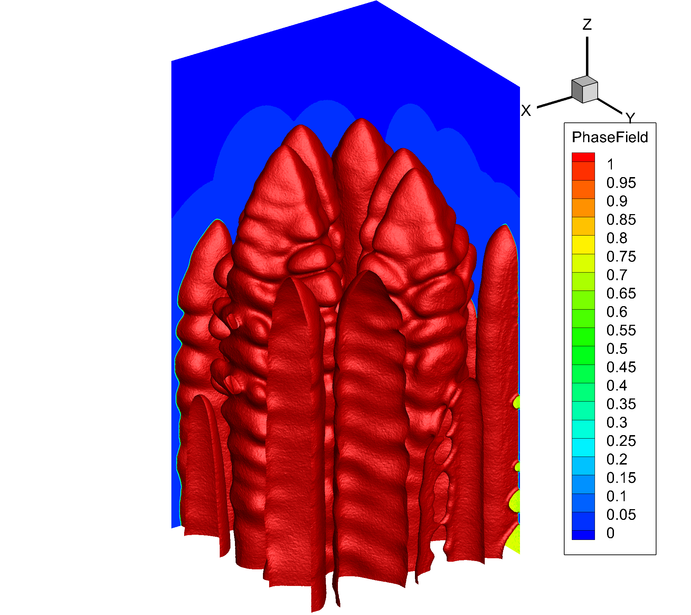
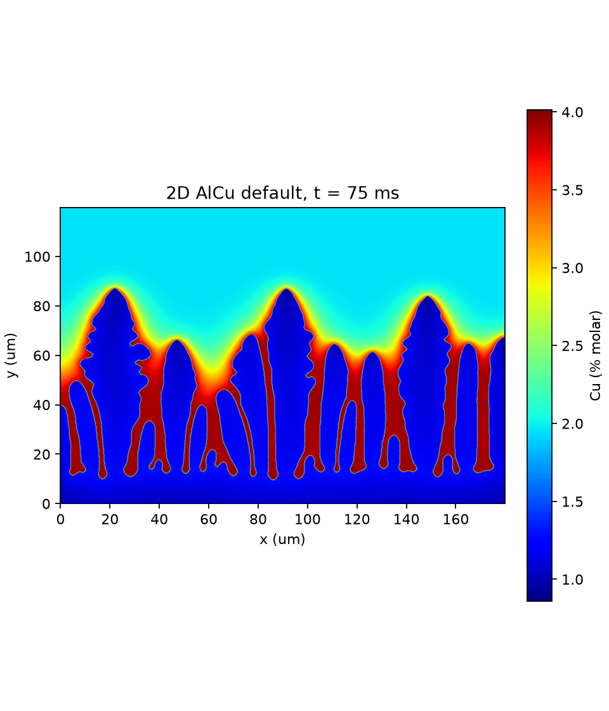
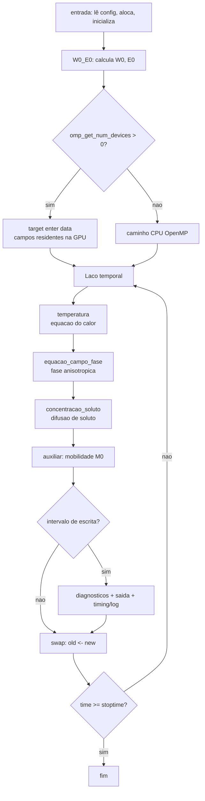

# Phase-Field 3D — Solidificação Dendrítica de Ligas (Al–Cu)


Simulação **3D de campo de fase** (*phase-field*) para o crescimento dendrítico
durante a solidificação de uma liga binária **Al–Cu**, resolvendo de forma acoplada
os campos de **fase**, **concentração de soluto** e **temperatura** em uma malha
cartesiana de diferenças finitas.

O código executa em **CPU (OpenMP multithread)** e, de forma transparente, em
**GPU (OpenMP *target offloading*)** — a escolha é feita **em tempo de execução**,
a partir de um **único executável**, sem alterar o algoritmo numérico.

<table align="center">
  <tr>
    <td align="center"></td>
    <td align="center"></td>
  </tr>
  <tr>
    <td align="center"><em>3D, t = 75 ms: vermelho = sólido (iso-superfície &phi; = 0,5),<br>azul = líquido (paredes x = 0 e y = 0). Domínio 51×51×105 µm.</em></td>
    <td align="center"><em>2D, t = 75 ms: concentração de Cu (% molar).<br>Domínio 180×120 µm.</em></td>
  </tr>
</table>

<p align="center">
  <em>Dendritas colunares de Al–Cu com os mesmos parâmetros (T0 = 922 K, resfriamento de
  19,84 K/s) em 3D e no código 2D original. Detalhes e roteiro para repetir em
  <a href="docs/run6/">docs/run6</a>.</em>
</p>

---

## ✨ Destaques

- **Um código, dois caminhos.** Detecta a GPU em tempo de execução
  (`omp_get_num_devices()`); se houver um dispositivo de *offload*, os *kernels*
  rodam na GPU; caso contrário, usa-se a implementação CPU/OpenMP já existente.
- **Dados residentes na GPU.** Os sete campos ficam na memória do dispositivo
  durante todo o laço temporal (`target enter/exit data`) — praticamente nenhuma
  transferência CPU↔GPU dentro do laço.
- **Equivalência numérica.** Os corpos dos *kernels* são de **fonte única**
  (`INCLUDE`), então CPU e GPU produzem os mesmos resultados a menos de
  arredondamento de ponto flutuante (verificado).
- **Perfilamento embutido.** A cada escrita de resultados é impresso um resumo de
  desempenho (`omp_get_wtime`) e gravado um log acumulado do run.
- **Portável.** Compatível com `nvfortran` (NVIDIA HPC SDK), `ifx` (Intel),
  e diretivas OpenMP 5.x padrão (sem extensões proprietárias).

---

## 🧭 Fluxo do solver



---

## 📁 Estrutura do repositório

| Caminho | Descrição |
|---|---|
| `source/principal.f90` | Programa principal: laço temporal, seleção CPU/GPU, dados residentes, perfilamento |
| `source/variaveis.f90` | Módulo de variáveis globais e gerador de ruído (`declare target`) |
| `source/temperatura.f90` | *Kernel* da equação do calor |
| `source/equacao_campo_fase.f90` | *Kernel* da equação de campo de fase (anisotropia cúbica) |
| `source/concentracao_soluto.f90` | *Kernel* da difusão de soluto |
| `source/diagnosticos.f90` | Reduções de verificação (L2, energia livre, min/max, soluto total) |
| `source/*_body.inc` | Corpos dos *kernels* em **fonte única** (compartilhados CPU/GPU) |
| `source/entrada.f90` / `saida.f90` | Leitura de configuração / escrita de resultados (Tecplot) |
| `source/auxiliar.f90` / `W0_E0.f90` | Cálculo da mobilidade `M0` e dos parâmetros `W0`, `E0` |
| `entrada.dat` | Arquivo de configuração (parâmetros físicos, malha, tempo) |
| `phasefield_gpu.sh` | Build + execução na GPU NVIDIA via `nvfortran` (WSL2) |
| `compile_gpu.bat` / `compile.bat` | Builds Windows (Intel `ifx`, GPU Intel / CPU) |
| `tecplot/` | Macros do Tecplot que geram as figuras 3D (fase vermelho/azul e Cu) |
| `docs/run6/` | Dendritas colunares 3D com os valores default do 2D: `entrada.dat` de cada etapa, figuras, roteiro para repetir |
| `casos2D/` | Código 2D original (referência) |
| `registro_runs.md` | Registro de todos os runs e resultados |

---

## 🔧 Requisitos

| Alvo | Compilador | Observações |
|---|---|---|
| **CPU (OpenMP)** | Intel `ifx`, `gfortran`, `nvfortran`, LLVM `flang` | Qualquer compilador com OpenMP |
| **GPU NVIDIA** | NVIDIA HPC SDK (`nvfortran`) | Recomendado no Linux / **WSL2** |
| **GPU Intel** | Intel `ifx` | GPU com suporte a **fp64** (iGPUs geralmente não têm) |

---

## 🚀 Compilar e executar

### GPU NVIDIA (WSL2 + NVIDIA HPC SDK) — recomendado

O script `phasefield_gpu.sh` **auto-detecta** a versão do HPC SDK, o CUDA
empacotado e a *compute capability* da sua GPU.

```bash
cd /mnt/c/Users/ileao/OneDrive/Documentos/phasefield

bash phasefield_gpu.sh build      # compila
bash phasefield_gpu.sh run 30     # roda por 30 s (teste rápido)
bash phasefield_gpu.sh run        # roda completo (até stoptime; Ctrl-C para parar)
```

Confirmação de que está na GPU:

```
### GPU offload ENABLED -- 1 OpenMP target device(s) detected ###
```

> **Dica (WSL2):** o script já adiciona `/usr/lib/wsl/lib` ao `LD_LIBRARY_PATH`
> (onde fica `libcuda.so.1`). Sem isso, o *runtime* reporta 0 dispositivos e cai
> silenciosamente no caminho CPU.

### CPU (Intel ifx, Windows)

```bat
call setvars.bat          :: ambiente Intel oneAPI
call parallel_compile.bat :: gera phasefield3d_omp.exe (CPU OpenMP)
phasefield3d_omp.exe
```

### Forçar CPU num binário com GPU

```bash
OMP_TARGET_OFFLOAD=DISABLED ./phasefield3d_gpu_wsl
```

---

## ⚙️ Configuração (`entrada.dat`)

O código lê **o primeiro valor de cada linha** (as linhas 1–3 são cabeçalho). Os valores
seguintes ficam ao lado como histórico de runs anteriores, e o original fica em
`entrada.dat.backup`. O `entrada.dat` do repositório é o do **run6** (dendritas de
`docs/run6/`, liga Al-Cu com os valores default do código 2D):

| Linha | Parâmetro | Valor (run6) | Observação |
|---|---|---|---|
| 4 | `Tm` – temperatura de fusão (K) | 933,3 | Al puro |
| 5 | `T0` – temperatura inicial (K) | 922 | liquidus TL(C0) = Tm − Me·C0 ≈ 920,8 K; ajustar ao continuar um run |
| 6 | `delta_H` – calor latente (J/m³) | 0,891×10⁹ | |
| 7 | `E0` – coef. do gradiente ((J/m)^½) | 1,055×10⁻³ | recalculado em `W0_E0.f90` a partir de `Sigma` e da espessura da interface |
| 8 | `W0` – altura da barreira (J/m³) | 673,2×10³ | recalculado em `W0_E0.f90` |
| 9 | `M0` – mobilidade (m³/J s) | 1,9×10⁻³ | recalculada em `auxiliar.f90` (interface fina) |
| 10–11 | `D_s`, `D_l` – difusividade térmica (m²/s) | 6,59×10⁻⁵ / 3,24×10⁻⁵ | |
| 12–13 | `Cps`, `Cpl` – calor específico (J/m³K) | 2,93×10⁶ / 2,63×10⁶ | |
| 14–16 | `Nx`, `Ny`, `Nz` | 340, 340, 700 | 51×51×105 µm; ~4,4 GB na GPU |
| 17–19 | `dy`, `dx`, `dz` (m) | 1,5×10⁻⁷ | |
| 20 | `small` | 10⁻²³ | evita divisão por zero |
| 21 | `ANI` – número de pontas | 4 | anisotropia cúbica (4-fold) |
| 22 | `it_max` | 10⁹ | o run termina pelo `stoptime` |
| 23 | `AAA` – amplitude do ruído | 0,03 | referida ao dt do 2D; o código imprime o AAA efetivo (0,02) |
| 24 | `Teta_0` – direção preferencial (rad) | 0 | |
| 25 | `DELTA_EPSLON` – força da anisotropia | 0,03 | |
| 26 | `DELTA_T` (s) | 1,5×10⁻⁷ | **não usado**: o código usa dt = dx²/(7,5·D_liq) (`entrada.f90`) |
| 27–28 | `D_sol`, `D_liq` – difusividade do soluto (m²/s) | 3×10⁻¹³ / 3×10⁻⁹ | |
| 29 | `Ke` – coeficiente de partição | 0,14 | |
| 30 | `Me` – inclinação da liquidus (K/fração molar) | 640 | |
| 31 | `Vm` – volume molar (m³/mol) | 1,13×10⁻⁵ | |
| 32 | `R` – constante dos gases | 8,31451 | |
| 33 | `C0` – concentração inicial (fração molar) | 0,0196 | ~1,96 % Cu |
| 34 | `Thin_Interface` | 4 | espessura da interface = 4·dx |
| 35 | `Sigma` – energia de interface (J/m²) | 0,093 | |
| 36 | `Beta` | 1 | entra no cálculo de `M0` |
| 37 | `ajuste` | 2 | fator em `E0` e `M0` |
| 38 | `stoptime` (s) | 0,085 | tempo físico de parada |
| 39 | intervalo de escrita (passos) | 7500 | ~7,5 ms; ~7,8 GB por arquivo nesta malha |
| 40 | `TP` – temperatura isotérmica (K) | 905 | só vale com taxa = 0 na linha 42 |
| 41 | `tipo_inicial  R_semente` | `3  0` | 0 = frente plana (j≤4), 1 = semente esférica central, 2 = 1/8 de semente no canto, 3 = frente plana na base crescendo em +z, 4 = continuação de `restart.dat` (o 2º valor é então o deslocamento em camadas, veja abaixo); nas sementes, o 2º valor é o raio em células |
| 42 | `taxa  varreduras` | `19.84  2` | resfriamento contínuo TP = T0 − taxa·t (K/s), como no 2D; 2 varreduras da fase por passo, como no 2D |
| 43 | `h_quintico  ruido_tipo` | `0  0` | h(φ): 1 = quíntico, 0 = cúbico (2D); ruído: 0 = célula a célula de média positiva (2D), 1 = média zero, 2 = suave |

Os `entrada.dat` das continuações do run6 (run6b, run6c) estão em `docs/run6/`; deles
só mudam as linhas 5, 38 e 41.

### Continuar um run (`tipo_inicial = 4`) e referencial móvel

1. Copie um arquivo de saída para `restart.dat` na pasta do run (pode ser um link simbólico).
2. Na linha 41 use `4  K`, onde `K` é o número de camadas descartadas na base.
   O domínio "sobe" `K·dz`; as `K` camadas do topo são preenchidas com líquido na
   concentração do último plano. Com `K = 0` é uma continuação simples.
3. Ajuste `T0` (linha 5) para a temperatura no instante da retomada,
   `T0 = T0_original − taxa · t`, e `stoptime` (linha 38) para o tempo que falta.

O contador de passos volta a 1 na retomada. Tempo real = instante da retomada + t;
z real = z + soma dos deslocamentos. O ruído é determinístico (`pseudo_random(i,j,k,it)`),
então os mesmos fontes, `entrada.dat` e pontos de retomada reproduzem o mesmo resultado.

---

## 📤 Saída

- **Campos** → `output/saida_<IT>_time_<t>s.dat` em formato **Tecplot `POINT`**
  (colunas `X, Y, Z, PhaseField, Temp, Conc_Solute`).
  ⚠️ Cada *snapshot* é grande (~1–2 GB para malhas de ~10⁷ pontos).
- **Desempenho** → `performance_log.txt`, que **acumula** o registro de todos os
  intervalos de escrita do run (cabeçalho, diagnósticos e bloco de *timing*).

Exemplo do resumo impresso a cada escrita:

```text
--------------------------------------------------------
Output Number          : 1
Simulation Time        : 0.0001
Iteration              : 501
Execution Device       : GPU (OpenMP target offload)
GPU Device ID          : 0
Available Devices      : 1
OpenMP Threads         : 20
Elapsed Time           : 42.18 s
Time Since Last Output : 4.03 s
Average Time/Step      : 0.084 s
Completed              : 0.02 %
Estimated Remaining    : 2727151.0 s
--------------------------------------------------------
```

---

## 📊 Figuras 3D no Tecplot

As figuras de `docs/run6/` são geradas pelas macros de [`tecplot/`](tecplot/)
(Tecplot 360 EX 2017 R2), em modo batch:

| Macro | Figura |
|---|---|
| `tecplot/dendrita_wbm_fase.mcr` | Sólido **vermelho** (iso-superfície φ = 0,5) e paredes x = 0, y = 0 coloridas pelo PhaseField (**azul** = líquido) |
| `tecplot/dendrita_wbm.mcr` | Mesma iso-superfície colorida pela concentração de Cu |

**Como a figura vermelho/azul é montada** (`dendrita_wbm_fase.mcr`):

1. Lê o arquivo em `Cartesian3D` (variável 4 = PhaseField, 6 = Conc_Solute).
2. **Sólido vermelho**: iso-superfície em PhaseField = 0,5 (a interface), pintada com cor
   sólida e não pelo contorno, com iluminação Gouraud, que dá o relevo dos braços:
   ```
   $!IsoSurfaceAttributes 1  Isovalue1 = 0.5
   $!IsoSurfaceAttributes 1  Contour { Show = No }
   $!IsoSurfaceAttributes 1  Shade { Show = Yes  Color = Red  UseLightingEffect = Yes }
   $!IsoSurfaceAttributes 1  Effects { LightingEffect = Gouraud }
   ```
3. **Paredes azuis**: dois *slices* em x = 0 e y = 0 com *flood* do PhaseField de 0 a 1
   (21 níveis): líquido azul, sólido vermelho; a faixa azul-clara perto das pontas é a
   camada difusa da interface.
4. Vista PSI = 65°, Theta = 215°, `View Fit`, exporta PNG de 2000 px.

**Uso:**

1. O Tecplot do Windows não lê o WSL: copie o arquivo de saída para uma pasta do Windows,
   por exemplo `cp ~/run/output/saida_*7501_* /mnt/c/pf_resultados/saida_wbm.dat`.
2. Ajuste `|ARQ|` (arquivo de entrada) e `|PNG|` (imagem) no topo da macro.
3. Rode:
   ```bat
   "C:\Program Files\Tecplot\Tecplot 360 EX 2017 R2\bin\tec360.exe" -b -p tecplot\dendrita_wbm_fase.mcr
   "C:\Program Files\Tecplot\Tecplot 360 EX 2017 R2\bin\tec360.exe" -b -p tecplot\dendrita_wbm.mcr
   ```
   ou pela interface: *Scripting → Play Macro/Script*.

Para a malha 340×340×700 cada arquivo tem ~7,8 GB em texto e cada figura leva ~40 min.

---

## 🔬 Modelo físico

- **Campo de fase** com anisotropia **cúbica (4-fold)** expressa diretamente a
  partir de `grad(phi)` — generalização 3D da formulação 2D de Kobayashi.
- **Soluto** com modelo de partição dependente da fase (`Ke`) e difusividades
  distintas em sólido/líquido.
- **Temperatura** via equação do calor com termo-fonte de liberação de calor
  latente na interface.
- Discretização por **diferenças finitas** com atualização **Jacobi
  (duplo-buffer)** — cada ponto é independente, o que torna os *kernels*
  seguros para paralelização em CPU e GPU.

---

## ⚠️ Notas

- Rodar a partir de `/mnt/c` (OneDrive) no WSL é lento devido ao *bridge* 9p e à
  sincronização do OneDrive. Para desempenho, copie o projeto para o sistema de
  arquivos nativo do Linux (`~/`) e rode de lá.
- iGPUs Intel sem `fp64` em *hardware* **não** executam estes *kernels* (que são
  todos em precisão dupla).

---

## 📜 Licença

Defina a licença desejada (ex.: adicione um arquivo `LICENSE`).
