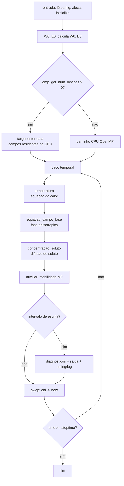

# Phase-Field 3D — Solidificação Dendrítica de Ligas (Al–Cu)


Simulação **3D de campo de fase** (*phase-field*) para o crescimento dendrítico
durante a solidificação de uma liga binária **Al–Cu**, resolvendo de forma acoplada
os campos de **fase**, **concentração de soluto** e **temperatura** em uma malha
cartesiana de diferenças finitas.

O código executa em **CPU (OpenMP multithread)** e, de forma transparente, em
**GPU (OpenMP *target offloading*)** — a escolha é feita **em tempo de execução**,
a partir de um **único executável**, sem alterar o algoritmo numérico.

---

## ✨ Destaques

- **Um código, dois caminhos.** Detecta a GPU em tempo de execução
  (`omp_get_num_devices()`); se houver um dispositivo de *offload*, os *kernels*
  rodam na GPU; caso contrário, usa-se a implementação CPU/OpenMP já existente.
- **Dados residentes na GPU.** Os sete campos ficam na memória do dispositivo
  durante todo o laço temporal (`target enter/exit data`) — praticamente nenhuma
  transferência CPU↔GPU dentro do laço.
- **Equivalência numérica.** Os corpos dos *kernels* são de **fonte única**
  (`INCLUDE`), então CPU e GPU produzem os mesmos resultados a menos de
  arredondamento de ponto flutuante (verificado).
- **Perfilamento embutido.** A cada escrita de resultados é impresso um resumo de
  desempenho (`omp_get_wtime`) e gravado um log acumulado do run.
- **Portável.** Compatível com `nvfortran` (NVIDIA HPC SDK), `ifx` (Intel),
  e diretivas OpenMP 5.x padrão (sem extensões proprietárias).

---

## 🧭 Fluxo do solver



---

## 📁 Estrutura do repositório

| Caminho | Descrição |
|---|---|
| `source/principal.f90` | Programa principal: laço temporal, seleção CPU/GPU, dados residentes, perfilamento |
| `source/variaveis.f90` | Módulo de variáveis globais e gerador de ruído (`declare target`) |
| `source/temperatura.f90` | *Kernel* da equação do calor |
| `source/equacao_campo_fase.f90` | *Kernel* da equação de campo de fase (anisotropia cúbica) |
| `source/concentracao_soluto.f90` | *Kernel* da difusão de soluto |
| `source/diagnosticos.f90` | Reduções de verificação (L2, energia livre, min/max, soluto total) |
| `source/*_body.inc` | Corpos dos *kernels* em **fonte única** (compartilhados CPU/GPU) |
| `source/entrada.f90` / `saida.f90` | Leitura de configuração / escrita de resultados (Tecplot) |
| `source/auxiliar.f90` / `W0_E0.f90` | Cálculo da mobilidade `M0` e dos parâmetros `W0`, `E0` |
| `entrada.dat` | Arquivo de configuração (parâmetros físicos, malha, tempo) |
| `phasefield_gpu.sh` | Build + execução na GPU NVIDIA via `nvfortran` (WSL2) |
| `compile_gpu.bat` / `compile.bat` | Builds Windows (Intel `ifx`, GPU Intel / CPU) |

---

## 🔧 Requisitos

| Alvo | Compilador | Observações |
|---|---|---|
| **CPU (OpenMP)** | Intel `ifx`, `gfortran`, `nvfortran`, LLVM `flang` | Qualquer compilador com OpenMP |
| **GPU NVIDIA** | NVIDIA HPC SDK (`nvfortran`) | Recomendado no Linux / **WSL2** |
| **GPU Intel** | Intel `ifx` | GPU com suporte a **fp64** (iGPUs geralmente não têm) |

---

## 🚀 Compilar e executar

### GPU NVIDIA (WSL2 + NVIDIA HPC SDK) — recomendado

O script `phasefield_gpu.sh` **auto-detecta** a versão do HPC SDK, o CUDA
empacotado e a *compute capability* da sua GPU.

```bash
cd /mnt/c/Users/ileao/OneDrive/Documentos/phasefield

bash phasefield_gpu.sh build      # compila
bash phasefield_gpu.sh run 30     # roda por 30 s (teste rápido)
bash phasefield_gpu.sh run        # roda completo (até stoptime; Ctrl-C para parar)
```

Confirmação de que está na GPU:

```
### GPU offload ENABLED -- 1 OpenMP target device(s) detected ###
```

> **Dica (WSL2):** o script já adiciona `/usr/lib/wsl/lib` ao `LD_LIBRARY_PATH`
> (onde fica `libcuda.so.1`). Sem isso, o *runtime* reporta 0 dispositivos e cai
> silenciosamente no caminho CPU.

### CPU (Intel ifx, Windows)

```bat
call setvars.bat          :: ambiente Intel oneAPI
call parallel_compile.bat :: gera phasefield3d_omp.exe (CPU OpenMP)
phasefield3d_omp.exe
```

### Forçar CPU num binário com GPU

```bash
OMP_TARGET_OFFLOAD=DISABLED ./phasefield3d_gpu_wsl
```

---

## ⚙️ Configuração (`entrada.dat`)

Cada linha traz o valor lido seguido de um comentário. Parâmetros principais:

- Temperaturas (`Tm`, `T0`), calor latente, tensão superficial, difusividades
- Malha: `Nx`, `Ny`, `Nz` e passos `dx`, `dy`, `dz`
- `DELTA_EPSLON` (força da anisotropia), coeficiente de partição `Ke`, `C0`
- `stoptime` (tempo físico de parada)
- `WriteFileD_timeCounter` (**intervalo de escrita**, em nº de passos)

---

## 📤 Saída

- **Campos** → `output/saida_<IT>_time_<t>s.dat` em formato **Tecplot `POINT`**
  (colunas `X, Y, Z, PhaseField, Temp, Conc_Solute`).
  ⚠️ Cada *snapshot* é grande (~1–2 GB para malhas de ~10⁷ pontos).
- **Desempenho** → `performance_log.txt`, que **acumula** o registro de todos os
  intervalos de escrita do run (cabeçalho, diagnósticos e bloco de *timing*).

Exemplo do resumo impresso a cada escrita:

```text
--------------------------------------------------------
Output Number          : 1
Simulation Time        : 0.0001
Iteration              : 501
Execution Device       : GPU (OpenMP target offload)
GPU Device ID          : 0
Available Devices      : 1
OpenMP Threads         : 20
Elapsed Time           : 42.18 s
Time Since Last Output : 4.03 s
Average Time/Step      : 0.084 s
Completed              : 0.02 %
Estimated Remaining    : 2727151.0 s
--------------------------------------------------------
```

---

## 🔬 Modelo físico

- **Campo de fase** com anisotropia **cúbica (4-fold)** expressa diretamente a
  partir de `grad(phi)` — generalização 3D da formulação 2D de Kobayashi.
- **Soluto** com modelo de partição dependente da fase (`Ke`) e difusividades
  distintas em sólido/líquido.
- **Temperatura** via equação do calor com termo-fonte de liberação de calor
  latente na interface.
- Discretização por **diferenças finitas** com atualização **Jacobi
  (duplo-buffer)** — cada ponto é independente, o que torna os *kernels*
  seguros para paralelização em CPU e GPU.

---

## ⚠️ Notas

- Rodar a partir de `/mnt/c` (OneDrive) no WSL é lento devido ao *bridge* 9p e à
  sincronização do OneDrive. Para desempenho, copie o projeto para o sistema de
  arquivos nativo do Linux (`~/`) e rode de lá.
- iGPUs Intel sem `fp64` em *hardware* **não** executam estes *kernels* (que são
  todos em precisão dupla).

---

## 📜 Licença

Defina a licença desejada (ex.: adicione um arquivo `LICENSE`).
